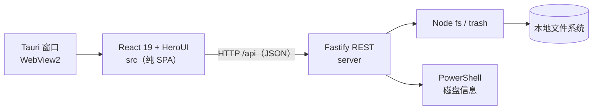

# Oriel

> 一个跑在 Windows 上的 Finder 风格文件管理器 —— Tauri 2 + React 19 + 本地 Fastify 服务。

一个跑在 Windows 上的、macOS Finder 风格的资源管理器基座。

前端用 React + TypeScript + HeroUI v3（Tailwind CSS v4），文件系统能力由一个本地
Node/TypeScript REST 服务提供，桌面外壳使用 Tauri 2。

> 当前版本已打通：浏览、导航、流式搜索、选择、新建/重命名/复制/剪切/粘贴/删除、
> 图标/列表视图（分组、密度、每文件夹视图记忆）、外观（主题/强调色/缩放/字体/毛玻璃）、
> 缩略图与预览面板、**目录实时监听**、**拖放移动**、**后台传输任务（字节进度/暂停/取消/重试）**、
> **压缩包浏览与解压**、**回收站**、**系统右键菜单融合**、**应用内更新检查与下载**、**撤销**与**可编辑地址栏**。

## 技术栈

| 层 | 选型 |
| --- | --- |
| 桌面外壳 | Tauri 2（无边框窗口 + 自绘红绿灯；Rust 侧通过 `windows` crate 调 Shell COM） |
| 前端 | React 19、TypeScript、Vite 7、Tailwind CSS 4、HeroUI v3、zustand |
| 文件图标 | 文档用 Office 风格白页 + 角标；代码用 `simple-icons` 的语言官方 logo；快捷方式与可执行文件走 Windows Shell 提取真实图标；覆盖 **397 种扩展名 + 25 个特殊文件名**，未知扩展名回退成「扩展名角标」而不是空白页 |
| 后端 | Node 22、Fastify 5、`trash`（回收站） |
| 契约 | `packages/shared` 中的共享 DTO / 常量 |

## 架构



前端是纯客户端 SPA：页面由 Vite 构建、由 Tauri WebView 直接加载，**不由 Node 服务渲染**，
也没有 SSR。REST 服务只提供 JSON 数据与文件流，页面结构、交互和主题全部在 React 中完成。

- 服务只监听 `127.0.0.1`，默认端口 `8787`。
- 前端通过 `VITE_API_BASE_URL` 访问服务；CORS 只放行 Tauri 源与 Vite 开发源（`localhost:5173`、
  `127.0.0.1:5173`），其它 Origin 一律 403，避免本机任意网页调用这些文件操作接口。
- 共享包是「源码导出」的 TS 包：开发时由 tsx / Vite 直接消费，生产构建时由 tsup 打进服务端产物。

### HeroUI 使用范围

界面骨架以 HeroUI v3 组件为主，Finder 特有的文件画布保留自定义渲染：

| 场景 | HeroUI 组件 |
| --- | --- |
| 标题栏 | 自绘 Windows 式右上角窗口控制（最小化 / 最大化 / 关闭） |
| 工具栏 | `Button`、`Tooltip`、`ToggleButtonGroup`、`SearchField`、`Dropdown`、`Separator` |
| 侧栏 | `ListBox` + `ListBox.Section`、`Header`、`Label`、`Meter` |
| 设置页 | `ToggleButtonGroup`、`Switch`、`Button`，主题由 `ThemeProvider` 统一托管 |
| 文件操作菜单 | 自定义右键菜单（HeroUI 不提供 context menu），复用 HeroUI 的 token 与图标体系 |
| 对话框 | `Modal`、`Input`、`Label`、`Button` |
| 通知与状态 | `Toast.Provider` / `toast()`、`Spinner`、`Meter` |
| 文件网格 / 列表 | 自定义（图标、选中态、双击打开、Shift/Ctrl 多选） |
| 面包屑 | 自定义（需要客户端导航；HeroUI `Breadcrumbs` 基于 `href`，会在 SPA 里触发真实跳转） |

`src/components/AppProviders.tsx` 负责挂载 `ThemeProvider` 与 `Toast.Provider`；HeroUI v3 其余组件不需要
全局 Provider。图标分两套语言：

- **文档**（`md`、`txt`、`pdf`、Office、电子书…）画成 Office 文件的样子：白页 + 右上折角 + 淡色内容线 +
  左下角彩色角标；`readme.md` 就是 Word 文档造型配灰色 `M`。
- **代码**（`ts`、`py`、`rs`、`go`…）直接用各语言官方 logo（来自 `simple-icons`），按品牌色绘制，
  不带白色底页。

`.lnk` / `.url` / `.exe` / `.msi`、Office、PDF、电子书、压缩包这类条目会额外调用 `POST /api/fs/icons`，
由服务端调用 PowerShell（`PrivateExtractIcons` + `SHGetImageList`，优先读取快捷方式自带的 `IconLocation`）
提取真实应用图标，裁剪透明边距后以 data URL 返回；拿不到图标或只拿到 Windows 的「空白页」
（用哨兵文件做指纹比对）时，回落到上面两套本地图标。
结果按 `路径 + mtime` 存进 IndexedDB，下次打开同一目录首帧就有真实图标，不再等 PowerShell。
图片则走 `GET /api/fs/thumbnail`，前端使用共享的 `IntersectionObserver` 做到仅对可见条目发起请求。

### 原生 Shell 桥（Tauri 侧）

REST 服务负责文件操作，但有几件事只有 Windows Shell 能做好，放在 `src-tauri/src/shell.rs`：

| 命令 | 作用 |
| --- | --- |
| `open_properties(path)` | 打开系统「属性」对话框（安全/权限/详细信息/以前的版本），获得 ACL 编辑能力 |
| `shell_delete(paths, permanent)` | `IFileOperation` 删除；`permanent=false` 时进真实回收站并带撤销记录 |
| `shell_move(paths, target)` | `IFileOperation` 移动（跨卷时显示系统进度） |
| `shell_verbs(path)` | 枚举系统为该文件提供的命令（7-Zip、发送到、网盘、扫描…），供应用菜单使用 |
| `shell_invoke_verb(path, id)` | 执行其中一条命令（`id - idCmdFirst` 作为 verb 偏移） |
| `shell_context_menu(path)` | 弹出完整系统右键菜单，含子菜单（「显示更多选项…」） |

前端通过 `src/lib/shell.ts` 调用；在纯浏览器（`npm run dev`）下检测不到 Tauri，会自动回退到 REST 接口，
功能不缺失。删除会优先走原生实现，失败时回退 REST。

## 目录结构

```text
.
├── src                  # React + HeroUI 前端（Vite 根目录）
│   ├── components
│   ├── hooks
│   ├── lib
│   └── store
├── src-tauri            # Tauri 配置 / Rust 入口
├── server               # REST API（Fastify）
│   ├── scripts          # inject 冒烟测试
│   └── src
│       ├── lib          # 路径安全、目录读取、磁盘、特殊目录
│       └── routes       # /system、/fs
├── packages/shared      # 前后端共享类型
├── scripts              # 图标生成
├── index.html
├── vite.config.ts
└── package.json         # 前端依赖 + npm workspaces + 开发编排
```

## 快速开始

前置：Node ≥ 22.12、npm 10、Rust 1.77+、Windows 10/11（WebView2）。

```bash
npm install

# 1) 只跑浏览器版（最快，用于调界面）
npm run dev
# 打开 http://localhost:5173

# 2) 跑桌面版（会自动等待 8787 与 5173 就绪）
npm run dev:all
```

`npm run dev` 会同时启动：

- REST 服务：`http://127.0.0.1:8787/api`
- Vite：`http://localhost:5173`

如果只想单独启动其中一端：

```bash
npm run dev:server
npm run dev:web
npm run dev:desktop   # 需要前两者已经运行
```

### 生成应用图标（可选）

```bash
node scripts/generate-icon.mjs
npm run icon
```

## 常用脚本

| 命令 | 作用 |
| --- | --- |
| `npm run dev` | 同时启动 REST + 前端（浏览器调试） |
| `npm run dev:all` | 启动 REST + 前端 + Tauri 窗口 |
| `npm run typecheck` | 前后端 TypeScript 检查 |
| `npm run smoke` | 对 REST 路由做 inject 冒烟测试（含真实文件操作） |
| `npm run build:web` | 构建前端静态资源 |
| `npm run build` | 构建 REST 服务产物 + 前端 |
| `npm run build:desktop` | 构建前端后执行 `tauri build` |

## REST API

统一前缀 `/api`，错误响应为 `{ "error": { "code", "message" } }`。

| 方法 | 路径 | 说明 |
| --- | --- | --- |
| GET | `/health` | 健康检查 |
| GET | `/system/info` | 平台、主机名、home、版本 |
| GET | `/drives` | 磁盘列表（容量 / 标签 / 类型） |
| GET | `/special` | 个人、桌面、下载、图片等快捷目录 |
| GET | `/system/fonts` | 已安装字体族列表（`InstalledFontCollection`，10 分钟缓存，带目录兜底） |
| GET | `/app/update` | 检查 GitHub Releases（`ORIEL_UPDATE_REPO=owner/repo`，未配置时如实返回） |
| POST | `/archive/extract` | `{ path, target, policy }` → 解压归档或其中一项 |
| POST | `/archive/create` | `{ sources[], target, name }` → 打包为 zip/7z |
| GET | `/fs/list?path=&showHidden=` | 列目录（文件夹优先、自然排序） |
| GET | `/fs/stat?path=` | 单条信息 |
| GET | `/fs/preview?path=` | 文本预览（512 KB 上限） |
| GET | `/fs/info?path=` | 扩展元信息（图片分辨率、PDF 页数、只读/链接） |
| GET | `/fs/size?path=` | 文件夹递归大小（worker 线程 + 60s 缓存） |
| POST | `/fs/sizes` | 批量查询 `{ paths[] }`，最多 3 个并发遍历 |
| GET | `/fs/media?path=` | 音视频内联流，支持 HTTP Range（206） |
| GET | `/fs/search?path=&q=&limit=` | 递归搜索（跳过 node_modules/.git/WinSxS 等；默认 10s 预算，可随连接中止） |
| GET | `/fs/search/stream?path=&q=&showHidden=` | SSE 流式搜索：`progress` / `matches` / `done`，断开即中止服务端遍历 |
| GET | `/fs/download?path=` | 文件下载流 |
| GET | `/fs/thumbnail?path=&size=` | 图片缩略图（webp，磁盘 + 内存缓存） |
| POST | `/fs/icons` | `{ paths[] }` → 快捷方式 / 可执行文件 / Office 文档的真实 Windows 图标 |
| POST | `/fs/entries` | `{ path, names[] }` → 只 stat 指定的子项（监听增量补丁用） |
| GET | `/fs/resolve?path=` | 展开 `~`、`%VAR%`、`$VAR` 并返回 `{ path, exists }` |
| POST | `/fs/conflicts` | `{ sources[], target }` → 同名冲突列表 |
| POST | `/fs/transfer` | `{ kind, sources[], target, policy }` → 后台任务（`copy`/`move`） |
| GET | `/fs/tasks/:id` | 查询单个传输任务进度 |
| POST | `/fs/tasks/:id/cancel` | 取消传输任务 |
| GET | `/events?watch=` | SSE：目录变更（含变动文件名）与所有任务进度 |
| POST | `/fs/mkdir` | `{ path, name }` |
| POST | `/fs/rename` | `{ path, newName }` |
| POST | `/fs/copy` | `{ sources[], target }` |
| POST | `/fs/move` | `{ sources[], target }` |
| POST | `/fs/delete` | `{ paths[], permanent? }`，默认进回收站 |
| POST | `/fs/clipboard` | `{ paths[], cut? }` → 把文件列表写入 Windows 剪贴板（CF_HDROP） |
| GET | `/fs/clipboard` | 读取系统剪贴板里的文件列表与“复制/剪切”意图 |
| POST | `/fs/open` | 用系统默认程序打开 |
| POST | `/fs/reveal` | 在资源管理器中定位 |
| GET | `/recycle` | 回收站列表（解析 `$Recycle.Bin` 的 `$I` 元数据，含原位置与删除时间） |
| POST | `/recycle/restore` | `{ ids[] }` → 还原到原位置（原位置已有同名项则跳过并说明原因） |
| POST | `/recycle/purge` | `{ ids[] }` → 永久删除指定项目 |
| POST | `/recycle/empty` | 清空回收站 |

路径必须为绝对路径；删除磁盘根目录、`Windows`、`Program Files`、`ProgramData`、用户目录根等
系统/服务目录会被拒绝。超过 260 字符的长路径会自动加上 `\\?\` 前缀（`server/src/lib/native-fs.ts`），
因此不依赖系统的 `LongPathsEnabled` 设置。

剪贴板互通由 `server/src/lib/clipboard.ts` 里一个**常驻的 PowerShell STA 宿主**完成：
每次新起进程要 400ms 左右，太慢，所以宿主在首次使用时启动，之后通过 stdin/stdout
一次一行 JSON 往返（读/写都在 10–30ms 级别），`Ctrl+V` 才能每次都向系统剪贴板要真实结果。

## 已实现的界面能力

- Finder 风格窗口：Windows 式右上角最小化 / 最大化 / 关闭、可拖拽标题栏、毛玻璃侧栏
- 侧栏收藏（个人 / 桌面 / 文稿 / 下载 / 图片 / 音乐 / 影片 / 应用程序）+ 磁盘
  - 会探测 OneDrive 重定向与中文目录名，所以 `桌面`、`图片` 在 OneDrive 环境下也能找到
- 默认过滤 Windows 已知系统项（`$Recycle.Bin`、`System Volume Information`、`pagefile.sys` 等），`Ctrl+H` 可显示
- 前进 / 后退 / 上一级、可点击面包屑
- 图标视图与列表视图均为**虚拟滚动**：只渲染视口附近的行（约 17 行），5000 个文件的目录也能秒开、滚动不卡
- 导航请求带序号，连点或快速跳目录时只采纳最新一次响应，旧响应不会把界面覆盖回去
- 图标视图与列表视图，按名称 / 日期 / 大小 / 种类排序
- 图标视图里图片（含 SVG）显示真实缩略图：进入视口才请求，服务端 `sharp` 生成并缓存，
  解码失败或非图片时自动回落到 SF Symbol
- 快捷方式 / Office / 压缩包的图标写入 IndexedDB（按 mtime 校验），重启后首帧即为真实图标；
  图标与缩略图都用交叉淡入取代硬切换
- 单选、Ctrl 多选、Shift 连选、方向键移动、滚动跟随
- 右键菜单（空白处 / 多选 / 单选三套）、新建文件夹、重命名、复制 / 剪切 / 粘贴、复制路径、
  显示简介、粘贴到文件夹、移到废纸篓、永久删除、撤销
  - 删除磁盘根目录、`Windows`、`Program Files`、`ProgramData`、用户目录根等系统目录会被服务端拒绝
- **跨应用复制粘贴（双向）**：`Ctrl+C/Ctrl+X` 除了维护应用内剪贴板，还会把文件列表写成
  Windows 的 `CF_HDROP` + `CFSTR_PREFERREDDROPEFFECT`（剪切 = move），
  所以可以直接到 QQ / 微信 / 资源管理器 / Word 里 `Ctrl+V`；反过来在资源管理器里复制的文件，
  回到本应用 `Ctrl+V` 也能粘进当前目录（以系统剪贴板为准，窗口重新获得焦点时自动同步）
- **目录实时监听**：`/events` 用 `fs.watch` 去抖 150ms 后把变动文件名推给前端，
  前端只对这几个名字调 `/fs/entries` 做增量补丁（重命名表现为旧的移除、新的插入），
  不重读整个目录；文件数变化才会退回全量比对
- **拖放移动**：把条目拖到文件夹图标、侧栏收藏/磁盘或空白画布即移动（拖拽时按住 `Ctrl` 为复制）；
  悬停 600ms 自动展开目标文件夹，拖拽源所在的旧列表会继续留在文档里（只是不可见），
  否则浏览器会因源节点被卸载而取消拖拽
- **后台传输任务**：复制/移动在服务端任务队列里跑，`/events` 推送进度，状态栏可看到
  「正在复制 3/12 文件名」与取消按钮；同名冲突弹窗提供保留两者 / 替换 / 跳过 / 取消
  - 进度按**字节**统计（`bytesDone / bytesTotal`），取消在 1 MiB 块级别生效，
    单个大文件也能中断；失败或取消会删除本次已写入的目标，不留半成品
  - 「替换」先把新内容落到 `.oriel-new` 暂存目录再原子换入，拷贝失败不会丢掉原文件
- **永久删除需二次确认**：`Shift+Delete` 或右键「永久删除」会弹出确认框，列出待删项目
- **撤销**：`Ctrl+Z` 反向执行移动、重命名与复制（暂存 20 步）。删除不进撤销栈。
- **可编辑地址栏**：`Ctrl+L`、双击面包屑或右侧笔按钮进入编辑，支持 `~`、`%TEMP%`、`$HOME`
  与直接粘贴路径，回车前用 `/fs/resolve` 校验存在性（不存在标红）
- **多选汇总**：状态栏显示选中数量、文件数 / 文件夹数、合计大小（文件夹大小未算出时显示 `≥`）
- **外观设置**（设置 → 外观）：主题、强调色（6 色，写入 `--color-mac-blue` 变量）、界面缩放
  （90/100/110/125%，走根元素 `zoom`，列表列数按实测宽度自动收敛）、网格图标大小（小/中/大）、
  列表密度（紧凑/标准/宽松，虚拟滚动行高同步）、字体族（从本机 **323 款已安装字体** 中搜索选择，
  每行以该字体渲染预览，另有系统默认/衬线/等宽预设）、
  显示文件扩展名、动态效果开关、毛玻璃强度（关闭后改实色，低端 GPU 更顺）
- **布局与视图记忆**：设置 → 外观 → 布局可一键重置侧栏/预览宽度；每个文件夹记住自己的
  视图模式、排序、分组和滚动位置（上限 300 个目录，可清除）
- **右键菜单**：系统命令以嵌套子菜单形式融入应用菜单（7-Zip 的解压项、发送到、CRC SHA 等
  多级菜单都在应用内弹出）
  - 飞出菜单用 portal + `fixed` 定位，按视口四边夹取：右侧不够就向左翻，底部不够就上移，
    超高时自身滚动；关闭有 140ms 宽限期，斜着移到子项不会误关
  - 根菜单也有视口高度上限并自身滚动，30 项以上的长菜单不会跑出屏幕（缩放 125% 时同样成立）
- **顶部工具栏**：后退/前进/上一级/**刷新** · 图标/列表切换 · **视图选项**（图标大小、列表密度、
  文件扩展名、预览面板）· **排序（含方向箭头与升序/降序）** · **分组（有生效时显示蓝点）** ·
  **新建（文件夹 / 文本文档）** · 搜索 · 预览开关 · 更多（隐藏文件、资源管理器、**在此处打开终端**、
  复制路径、刷新、设置）；窗口或缩放变窄时自动收起文字标签只留图标
- **分组**：工具栏「分组」下拉，可按名称（A–Z/数字/其他）、种类（文件夹/图像/影片/音乐/文档/压缩包/代码）、
  修改日期（今天/昨天/本周/本月/今年/更早）、大小分组；列表视图渲染吸顶分组头并显示计数，
  选择分组时会自动切到列表视图（分组头需要整行宽度）
- **系统属性窗口**：右键「属性…」直接打开 Windows 的属性对话框（权限/安全/详细信息），桌面版可用
- **右键菜单可配置**：设置分页为「外观 / 浏览 / 右键菜单 / 本地服务 / 关于」
  - 右键菜单页整页跟随「文件夹 / 文件 / 空白处」三种模式：左侧只列出该模式菜单里的项目
    （应用项按适用范围过滤，系统项用该模式的真实样本探测），右侧是同一模式的**实时预览**，
    预览用的就是真实菜单组件；空白处（画布）菜单也能逐项开关
  - 系统项样本自动挑一个真实文件（跳过 .ini/.lnk 这类贫瘠类型），所以「打开方式 / 文件压缩 /
    批量改文档格式」这类文件专属命令只在文件模式出现
  - 右键时按「文件夹 / 文件扩展名」缓存并后台预热系统命令，菜单一次成型，
    不会先弹出再补上系统项
- **系统菜单融合**：右键菜单里直接列出系统为该文件提供的命令（7-Zip、发送到、网盘、WPS、
  Defender 扫描…），与应用自己的项目共用同一套样式
  - 子菜单类命令（7-Zip、发送到）以 `…` 结尾，点击后走完整原生菜单
  - 「显示更多选项…」保留完整 Windows 菜单（`TrackPopupMenuEx` 必须跑在主线程，因为菜单消息
    由 owner 窗口所属线程接收）
  - 枚举菜单项时对 owner-draw 项跳过 `MIIM_STRING` 读取，否则 `dwTypeData` 会被当成指针读取而损坏堆
- **删除走系统 API**：桌面版删除通过 `IFileOperation` 进回收站，Explorer 里也能看到的同一条撤销记录
- **压缩包浏览**：双击 zip/7z/rar/tar/gz/iso 等直接进入只读虚拟目录
  （`archive://<归档>|<内部路径>`），面包屑显示 `… › demo.zip › docs`，归档内可预览文本/图片、
  看缩略图、右键「解压到当前文件夹 / 同名文件夹」，选中多个可「压缩为 ZIP」；
  归档内的写操作（新建/重命名/删除/拖入）会被拒绝并提示只读
  - 依赖 7-Zip：按注册表 `7-Zip\Path` → PATH → 常见目录 顺序定位，未安装时给出明确提示
  - `7z l -slt -ba` 解析 + 按 `(归档, mtime, size)` 缓存；条目上限 5 万，防压缩炸弹
- **操作中心**：状态栏「任务 N」打开，列出复制/移动任务的字节进度、速度、剩余时间，
  支持暂停/继续（暂停会真正停住读取流，而不是只改状态）、取消、重试、清除已完成
- **废纸篓**：侧栏入口，列出回收站项目（名称 / 原位置 / 删除时间 / 大小），支持单个或批量还原、
  永久删除与清空；直接读 `$Recycle.Bin` 的 `$I/$R` 配对文件，不依赖 PowerShell，列表虚拟滚动
- **PDF 内嵌预览**：预览面板直接用 WebView2 自带阅读器渲染（`/fs/media` 支持 Range 与 `inline`）
- 递归搜索（防抖、可取消、结果截断提示）
  - 服务端遍历是**深度优先 + 时间预算**（默认 10s，上限 80 万条目），跳过 `WinSxS`、`DriverStore`、
    `Installer` 等系统目录；从盘符根搜索时会先走用户目录，再走 `Windows`／`Program Files`
  - 结果通过 SSE 流式返回，边扫边出；改搜索词会关闭上一条流，服务端遍历立即中止
  - 截断或超时会在状态栏与结果头部标注已扫描条目数
- 隐藏文件开关、浅色 / 深色 / 跟随系统外观
- 设置页：主题、默认视图、显示隐藏文件、启动位置、本地服务状态与恢复默认设置
- 右侧预览面板（300px，可拖动左边缘调整宽度 220–560，空格开关）：
  - 图片：512px 缩略图 + 分辨率/格式
  - 音视频：内联 `<video>`/`<audio>` 播放（Range 流）+ 时长
  - PDF：页数；文本/代码：内容预览 + 行数/字符数
  - 文件夹：递归大小与文件/子目录数量（超时或超量标注 `＋`）
  - 元信息：种类 / 大小 / 尺寸 / 时长 / 页数 / 修改 / 创建 / 位置；底部提供打开、定位、复制路径
- 列表视图的「大小」列会实时填入文件夹的递归大小：行进入视口才请求，同一轮的请求合并成一个批量接口，
  结果缓存在 store 与服务端（60s）；遍历在 worker 线程里用同步 fs 完成，8.4 万文件的目录约 0.9s，不阻塞主线程
- 状态栏显示项目数、选中数与磁盘可用空间

### 快捷键

| 快捷键 | 动作 |
| --- | --- |
| `Enter` | 打开 |
| `Backspace` | 上一级 |
| `Delete` | 移到废纸篓 |
| `Shift+Delete` | 永久删除 |
| `Ctrl+Z` | 撤销上一步移动 / 重命名 / 复制 |
| `Ctrl+L` | 编辑地址栏 |
| `F2` | 重命名 |
| `F5` / `Ctrl+R` | 刷新 |
| `Ctrl+C` / `Ctrl+X` / `Ctrl+V` | 复制 / 剪切 / 粘贴 |
| `Ctrl+A` | 全选 |
| `Ctrl+Shift+N` | 新建文件夹 |
| `Ctrl+H` | 显示隐藏文件 |
| `Ctrl+,` | 打开设置 |
| `Ctrl+1` / `Ctrl+2` | 图标视图 / 列表视图 |
| `Ctrl+[` / `Ctrl+]` | 后退 / 前进 |
| `空格` | 开关右侧预览面板 |
| `Esc` | 先关闭预览，再清空选择 |

## 发布、镜像与 CDN

```bash
# 本地打包（前端 + 服务端产物 + 安装包）
npm run build
npm run build:desktop

# 打 tag 后由 GitHub Actions 构建并创建 Release（见 .github/workflows/release.yml）
git tag v0.2.0 && git push origin v0.2.0
```

应用内「设置 → 关于 → 检查更新」读取 `ORIEL_UPDATE_REPO=owner/repo` 的 GitHub Releases；
代理/网络受限时可用 `ORIEL_UPDATE_CDN=<前缀>` 把下载地址改写成 `<前缀>/<tag>/<文件名>`，
把发布产物按同样层级同步到对象存储或 CDN 即可。

镜像到 Gitee：`git remote add gitee https://gitee.com/<owner>/Oriel.git`，之后
`git push gitee main --tags`；也可以在 Gitee 仓库设置里开启“强制同步”或使用
`.github/workflows/release.yml` 里的镜像步骤（需要配置 `GITEE_TOKEN`）。

## 已知限制与下一步

1. **打包时的服务端**：`tauri build` 目前只打包 WebView 前端，REST 服务需要在
   外部运行。下一步用 Tauri sidecar（随包携带 Node 运行时）或把服务编译成单文件
   可执行程序，并让 Tauri 启动时拉起、退出时关闭。
2. **预览能力**：图片、文本、音视频、PDF（内嵌阅读器）与文件夹大小已支持；Office 文档内容预览仍在路线图内。
3. **拖出到资源管理器**：当前只支持应用内拖放；向系统拖出文件需要 Tauri 的原生拖拽
   （第三方 `tauri-plugin-drag` 或自建 OLE 拖动源），尚未接入。
4. **标签页、分栏视图**：在路线图内。
5. **访问控制**：服务仅绑定回环地址，CORS 只放行已知前端来源，跨站请求直接 403。
   如需在局域网或其它前端访问，设置 `ORIEL_TOKEN`（服务端）与 `VITE_API_TOKEN`（前端）
   启用共享令牌；SSE 因 `EventSource` 无法带 header，改用 `?token=` 传递。
6. **隐藏属性**：Node 不暴露 Windows 文件属性，目前按名称过滤已知系统项；
   完整的 `FILE_ATTRIBUTE_HIDDEN` 支持需要原生调用或额外依赖。

## 说明

这是独立实现，仅借鉴 macOS Finder 的视觉语言，不包含 Apple 的任何素材。
