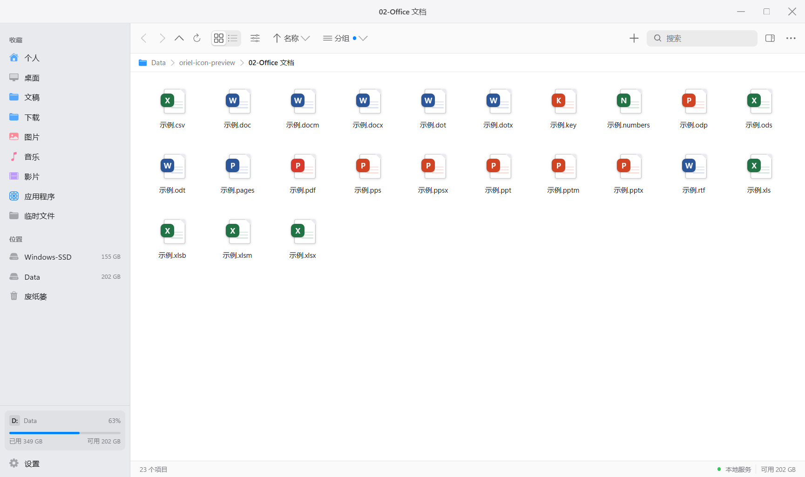
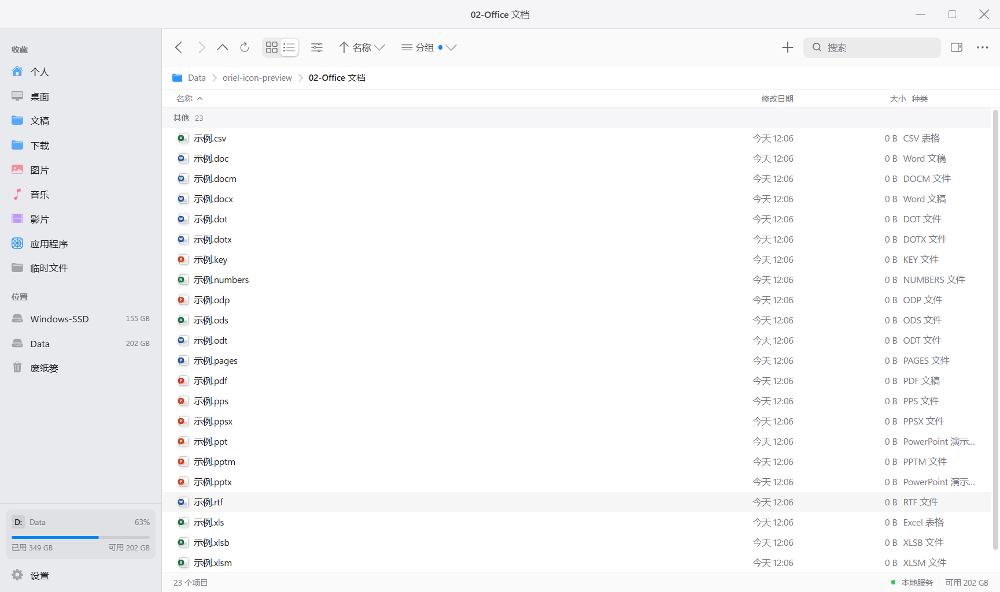
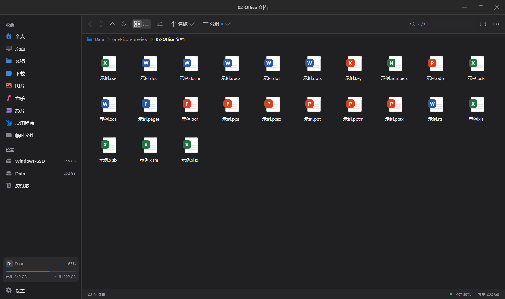

# Oriel

> 像 Finder 一样整理 Windows 上的文件。

大图标、空格预览、批量改名、整盘搜索、压缩包直接浏览。装好就能用，文件始终留在自己的电脑上。

## 下载

- [GitHub Releases](https://github.com/Soulmte/Oriel/releases/latest)
- [国内镜像（Gitee）](https://gitee.com/Soulmte/Oriel/releases)

支持 Windows 10 / 11（64 位）。安装包自带运行环境，不需要另外安装任何东西；安装过程也不需要管理员权限。

安装包没有代码签名，首次运行时 Windows 可能提示未知发布者，选择「更多信息」→「仍要运行」即可。

## 它是什么

Windows 上的文件管理器。界面按 macOS Finder 的习惯重画：左侧常用位置，顶部工具栏，大图标网格，右侧预览，底部状态栏。系统原有的桌面、任务栏和 `Win` + `E` 不会被替换。

适合每天要处理很多文件的人：整理照片、归档资料、改一批文件名、从压缩包里挑几项、在整块磁盘里找一份旧文档。

## 和资源管理器比

| 每天会碰到的事 | Windows 资源管理器 | Oriel |
| --- | --- | --- |
| 大图标与缩略图 | 标准图标，缩略图偏小 | 网格大图标，Office、PDF、程序和快捷方式都用真实图标 |
| 快速预览 | 预览窗格常驻，占地方 | 选中按空格打开，再按一次收起 |
| 批量改名 | 只能逐个修改 | 替换、编号、前后缀、大小写任意组合，改前先看预览 |
| 搜索 | 依赖索引，通常只查当前位置 | 默认搜整块磁盘，空格分词，结果边搜边出 |
| 压缩包 | zip 可浏览，7z 和 rar 要先解压 | zip、7z、rar 都能进去逛，只解压选中的项目 |
| 复制与移动 | 一条进度条，出错只能重来 | 操作中心里可以暂停、继续、重试、取消，失败会清理半成品 |
| 文件夹记忆 | 部分场景记住视图 | 每个文件夹各自记住视图、排序、分组和滚动位置 |
| 外观 | 跟随系统 | 浅色、深色、强调色、界面缩放、字体和毛玻璃 |
| 系统集成 | 系统本身 | 开机自启、托盘、文件夹右键菜单、设为默认打开方式 |
| 文件去向 | 本机 | 本机，不上传 |

对比的是 Windows 10 / 11 自带资源管理器的默认行为，不含第三方插件。

## 功能

### 浏览

- 网格与列表两种视图，随时切换
- 每个文件夹单独记住视图、排序、分组和滚动位置
- 左侧常用位置与磁盘，底部显示项目数、选中大小和可用空间
- 地址栏可直接编辑，支持前进、后退和上一级
- 右侧预览面板可以拖动调宽，也可以整体收起

### 查看

- 图片缩略图，列表缩到小尺寸时图标仍然清楚
- 空格预览图片、PDF、文本、音频和视频
- 文件夹大小按需计算，不阻塞当前操作
- 按名称、种类、日期或大小分组，组名滚动时吸顶

### 整理

- 新建文件夹，以及文本、Markdown、Word、Excel、PowerPoint 等常用文件
- 重命名时名称和扩展名分开写，文件夹不会出现多余的后缀行
- 多选后批量改名：查找替换、编号、前后缀、大小写可以叠加，右侧实时预览，重名和非法字符当场标红
- 复制、剪切、粘贴同时写入 Windows 剪贴板，可以直接粘到微信、QQ 或别的程序
- 拖放移动，悬停文件夹自动进入
- 删除进回收站，也可以永久删除；回收站支持还原、部分清空和全部清空
- 撤销最近一次改名、移动、复制或删除

### 查找

- 搜索范围：当前文件夹、此磁盘、所有磁盘
- 默认从整块磁盘找起，结果边扫边出现
- 空格分词，`report 2024` 能匹配 `2024-annual-report.pdf`，顺序不限
- `Ctrl` + `F` 直接跳到搜索框，`Esc` 停止并清空
- 系统目录自动跳过；结果条数或时间到上限时会明确提示

### 压缩包

- zip、7z、rar 当作只读文件夹浏览
- 可以进子目录、查看大小、只解压选中的项目
- 也可以把整包解压到旁边的文件夹

### 传输

- 复制、移动和更新下载都进操作中心
- 按字节显示进度，可以暂停、继续、重试或取消
- 失败时清理半成品，不会留下残缺的目录树

### 外观

- 浅色、深色、跟随系统
- 六种强调色
- 界面缩放 90%–125%
- 网格图标大小与列表密度
- 字体族从本机已安装字体中选择
- 毛玻璃强度可调，也可以关掉换成实色

### 系统集成

- 开机自启，登录后静默进入托盘
- 托盘图标可以隐藏；隐藏后会同时取消开机自启，避免找不到窗口
- 关闭窗口时最小化到托盘，也可以改成直接退出
- 文件夹、文件夹空白处和磁盘的右键菜单可以加「用 Oriel 打开」
- 可以注册为文件夹的默认打开方式，并跳到 Windows「默认应用」页面确认
- 从资源管理器打开文件夹时，直接把该目录带进 Oriel

Windows 不允许程序静默顶替资源管理器。Oriel 不会接管桌面、任务栏和 `Win` + `E`。

### 更新

- 设置 → 关于里检查更新，展示更新日志
- 下载带真实字节进度，可以取消
- 下载完成后「立即安装并退出」，安装程序接着完成更新
- 下载会先尝试国内镜像，再回落到 GitHub

## 常用快捷键

| 操作 | 快捷键 |
| --- | --- |
| 搜索 | `Ctrl` + `F` |
| 编辑地址栏 | `Ctrl` + `L` |
| 预览选中项 | `空格` |
| 打开 | `Enter` |
| 上一级 | `Backspace` |
| 前进 / 后退 | `Ctrl` + `[` / `]` |
| 重命名 / 批量改名 | `F2` |
| 新建文件夹 | `Ctrl` + `Shift` + `N` |
| 复制 / 剪切 / 粘贴 | `Ctrl` + `C` / `X` / `V` |
| 全选 | `Ctrl` + `A` |
| 删除到回收站 | `Delete` |
| 永久删除 | `Shift` + `Delete` |
| 撤销 | `Ctrl` + `Z` |
| 刷新 | `F5` |
| 显示隐藏文件 | `Ctrl` + `H` |
| 设置 | `Ctrl` + `,` |

## 界面

## 已知限制

- 还没有标签页和分栏视图
- 可以把文件拖进 Oriel，但还不能直接拖出到资源管理器
- 安装包未签名
- 桌面、任务栏和 `Win` + `E` 仍由 Windows 管理；Oriel 只替换文件夹窗口的打开方式

## 反馈

- [提交问题](https://github.com/Soulmte/Oriel/issues)
- [使用指南](https://soulmte.github.io/Oriel/docs.html)
